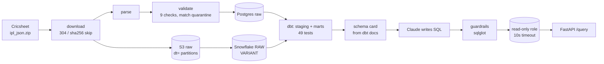

# CrickQL


Ask an IPL cricket question in plain English. Get the answer, and the SQL that produced it.

Under the question box is a real pipeline: Cricsheet ball-by-ball data, validated and loaded into Postgres (and Snowflake through S3), modeled and tested in dbt, orchestrated by Airflow, and served by a FastAPI agent that can only read.

> Status: Weeks 1-4 of 6. Text-to-SQL is live. The rules layer (RAG over the Laws of Cricket) and the router come next.

## Try it

```bash
git clone git@github.com:gnanendrart/crickql.git && cd crickql
export ANTHROPIC_API_KEY=sk-ant-...
docker compose up --build
```

The first start downloads the Cricsheet IPL archive (about 5 MB), loads it, and runs `dbt build` with every test. Then:

```bash
curl -s localhost:8000/query -H 'content-type: application/json' \
  -d '{"question": "Who scored the most runs in the 2016 season?"}'
```

Swagger UI: http://localhost:8000/docs. No internet? `SEED_MODE=fixtures docker compose up` starts with 3 sample matches.

## How it works



Airflow runs the pipeline weekly: `download >> upload_s3 >> [load_pg, load_snowflake] >> [dbt_build_pg, dbt_build_snowflake] >> dq_summary`.

## What it answers

1,243 matches and 295,732 deliveries, 2008 to 2026. Eight tables built for questions, not for storage:

| Table | One row per | Good for |
|---|---|---|
| `mart_batting_season` | batter, season, team | Orange caps, career runs, strike rates |
| `mart_bowling_phase` | bowler, season, team, phase | Death-over economy, powerplay wickets |
| `mart_team_season` | team, season | Titles, win %, run rates |
| `fct_matches` | match | Results, margins, toss, super overs |
| `fct_batting_innings` | batter, innings | Highest scores, fifties, ducks |
| `fct_deliveries` | ball | Batter vs bowler, anything else |
| `dim_players`, `dim_venues` | player, venue | Careers, grounds, chasing records |

## Results

Execution accuracy on a 30-question eval set (`evals/sql_eval.yaml`). The generated SQL and the hand-written gold SQL both run, and the result sets have to match.

| Run | Model | Accuracy |
|---|---|---|
| Not run yet | | |

Every number here comes from `evals/results.md`, which only the eval script writes.

## Design decisions

**Cricsheet, not scraping.** Cricsheet publishes ball-by-ball data for reuse. A scraped pipeline breaks when a site changes its HTML and can break its terms of use. This one is reproducible by anyone.

**Quarantine the whole match, not the bad row.** If one ball fails a check, the whole match is held back and logged. A match missing one ball looks complete and gives wrong totals. A missing match is visible.

**Test that the totals reconcile.** Cricsheet's official target is first-innings runs + 1. A dbt test rebuilds every first innings from ball-level rows and checks it against the target. Delete one ball from the raw table and the build fails. I checked.

**Refuse a load that shrinks.** Cricsheet only adds matches. If a new pull has more than 5% fewer rows than the last load, the pipeline stops before writing anything.

**The agent's context is the dbt docs.** The model sees one schema card, generated from the dbt model and column descriptions. Better documentation means better SQL, and there is no second copy of the schema to drift.

**The LLM never gets write access.** Two layers. sqlglot checks every query before it runs: one statement, SELECT only, marts tables only, no `pg_sleep` or file-reading functions, LIMIT added. Then it runs as `crickql_reader`, a role that can only SELECT from marts, is read-only by default, and is cut off at 10 seconds.

**A custom agent, not a framework.** It is about 200 lines: prompt, forced tool call, guardrails, execute, one retry with the error. Every step can be explained, and the same tool-use pattern carries into the router.

**Postgres and Snowflake from one dbt project.** Postgres is the free path a reviewer runs with `docker compose up`. Snowflake through S3 is the production path. One thin `base_` model per target makes both produce the same columns, so every model above it is shared.

## Run it without Docker

```bash
conda activate data-eng
pip install -r requirements.txt
cp .env.example .env               # fill in PG_* and ANTHROPIC_API_KEY
python run_pipeline.py             # download, validate, load, dbt build
psql -d crickql -f sql/postgres/roles.sql
python -m src.agent.text_to_sql "Which team has won the most titles?"
pytest -q
```

Airflow: `cd airflow && docker compose up --build`, then http://localhost:8080. Cloud steps run when the Airflow Variable `crickql_cloud` is `true`.

## Repo map

```
src/ingest/   download, parse, validate, guard, load_pg, upload_s3, load_snowflake, dq_summary
src/agent/    schema_context, guardrails, text_to_sql, examples.yaml
dbt/          staging + marts models, seeds (team and venue names), tests
airflow/      DAG + single-container Airflow 3
api/          FastAPI app
evals/        30-question SQL eval and runner
sql/          Postgres raw schema and read-only role, Snowflake stage and COPY
notebooks/    reconciliation against my earlier Kaggle load
```

## Data and licence

Match data from [Cricsheet](https://cricsheet.org), released under the Open Data Commons Attribution License. The three files in `tests/fixtures/` are Cricsheet match files kept for offline tests.
